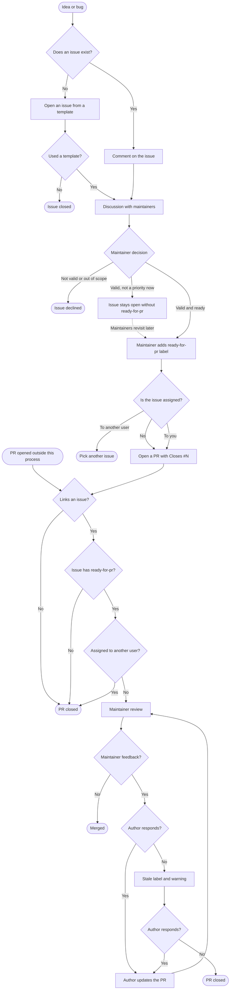

# Contributing to Plotly.js

Thanks for your interest in contributing to Plotly.js! This document outlines the general way that changes get made to this library and by whom, and then provides specific technical information about how to set up a development environment for doing development and running tests.

## Code of Conduct

Please check out our [Code of Conduct](code_of_conduct.md). Don't tl;dr it but the general idea is to be nice.

## Plotly.js vs Plotly.py

[Plotly.js](https://plotly.com/javascript) is a standalone JavaScript data visualization library, and it also powers [Plotly.py](https://plotly.com/python). There are also community maintained Plotly.js-powered libraries for other languages such as R, Julia, Scala, Rust, .NET and even C++!

The basic architecture of Plotly.js is to accept a [JSON](https://json.org/) representation of figures that adhere to the [figure schema](https://plotly.com/javascript/reference/index/) and draw interactive graphical representations of these figures in a browser. Libraries in other languages provide interfaces for users to create and manipulate these JSON structures, and render them with Plotly.js.

## How do changes get made to Plotly.js?

A **new feature** is composed of additions to the schema - adding new attributes, adding entire new trace types, or just adding new values to existing attributes - along with the associated drawing code.

This project has a strong commitment to backwards-compatibility. Therefore updates that change the current expected behavior of the library are limited to major releases or may not be accepted at all. The one exception to this is when a bug fix changes the library behavior for cases when the current graphical output is incorrect, nonsensical or otherwise problematic.

The [contribution flowchart](#contribution-flowchart) at the end of this document shows these steps as a diagram. The basic process for adding new features or fixing bugs is as follows:

1. **Discussion** - A user creates an issue to discuss the use-case for the new feature or bug fix.
  - Search the open and closed issues first. A closed issue often records the reason that we declined an idea.
  - New issues must use one of the provided templates. Those not using a template will be closed.
  - We may approve issues that report or request:
    - A bug or regression that could affect many users
    - A feature that will improve or expand the library
    - A performance problem in a realistic figure
    - An attribute description that is wrong or incomplete
  - We usually decline issues that report or request:
    - A problem that no user ran into, found only in the code or with a tool
    - A refactor, rename, formatting change, or syntax update
    - A typo in code comments, tests, or other text that users do not see
    - A change to current behavior outside a major release, unless the current output is incorrect
  - Only a maintainer can approve an issue. Reactions and agreement from other users do not count as approval.
2. **Issue Approval** - Work should not begin until the plan from the discussion is approved. Maintainers will add the `ready-for-pr` label at this point.
  - A maintainer can confirm a bug but leave the issue without the `ready-for-pr` label. We do not accept pull requests for such an issue until a maintainer adds the label.
  - Anyone can work on a `ready-for-pr` issue that has no assignee.
  - To reserve an issue, comment on the issue and ask for it. A maintainer then assigns you. Only the assignee can open a pull request for an assigned issue.
  - An issue has one assignee at a time.
  - If you can no longer work on the issue, say so in the issue so that a maintainer can assign someone else.
3. **Pull Request** - Anyone can now create a pull request for an unassigned issue. For an assigned issue, only the assignee can. Every pull request needs a linked issue. Pull requests without a linked issue will not be accepted.
  - Link the issue with a closing keyword in the pull request body, for example `Closes #1234`.
  - The linked issue must have the `ready-for-pr` label.
  - We close a pull request for an issue that is assigned to another user.
  - A workflow checks each new pull request and closes it if a check fails. Fix the problem, then ask a maintainer to reopen the pull request.
  - Keep the pull request to the approved plan. Open a new issue for other changes.
  - If a coding agent wrote the change, review the code and look at the rendered plot before you open the pull request.
4. **Review** - Maintainers will review the pull request, working with the original authors to ensure the code is ready for merging.
  - After a maintainer review, respond with a comment, a review, or a reaction. A push alone does not count as a response.
  - If the author does not respond, a workflow adds the `stale` label and posts a warning, and later closes the pull request.

### Plotly.js Documentation

[Proposing changes to the documentation of Plotly.js or associated projects](https://github.com/plotly/graphing-library-docs/blob/master/README.md) is an extremely valuable form of contribution.

Another source of information for the library is our community forum, where users [ask and answer questions](https://community.plotly.com/). Participating in these discussions is seen as another form of documentation, as it creates a record of a question and discussion, which others can stumble across later and use to further their own work.


## Opening issues

Please follow the [issue guidelines](./.github/ISSUE_TEMPLATE/) in the appropriate template.

## Making pull requests

Please follow the [pull request guidelines](./.github/PULL_REQUEST_TEMPLATE.md) and the notes in the steps above. The [contribution flowchart](#contribution-flowchart) shows the checks that a pull request must pass.

## Using a coding agent

If you prepare a contribution with a coding agent, point it at [AGENTS.md](AGENTS.md). That file and the [.agents](.agents/) folder state the rules an agent follows in this repository, including the steps it must leave to a human.

## Repo organization

- Distributed files are in `dist/`
- CommonJS entry points are in `lib/`: one per trace type, plus `index*.js` files that register the traces for the full and partial bundles
- Source files are in `src/`
- Build and repo management scripts are in `tasks/`
- All tasks can be run using [`npm run-script`](https://docs.npmjs.com/cli/run-script)
- Tests are in `test/`; they are partitioned into `image` and `jasmine` tests
- Test dashboard and image viewer code is in `devtools/`
- Built files are in `build/` (mostly git-ignored, with a few exceptions: see `build/README.md`)

## Development

#### Prerequisites

- [git](https://git-scm.com/)
- [node.js](https://nodejs.org/en/), at the version in [.nvmrc](./.nvmrc)
- [npm](https://www.npmjs.com/)
- [Python](https://www.python.org/downloads/)
- [uv](https://docs.astral.sh/uv/)

Dependencies can be seen in [package.json](./package.json).

#### Step 1: Clone your fork and create a dev branch

Fork the repository on GitHub, then clone your fork. The `upstream` remote lets you merge the latest changes from `main` into your branch.

```bash
git clone git@github.com:<your-GitHub-username>/plotly.js.git
cd plotly.js
git remote add upstream https://github.com/plotly/plotly.js.git
# Please do not use main for your dev branch
git switch -c dev-branch-name
```

#### Step 2: Set up the project

```bash
npm ci
npm run pretest
npm start
```

#### Step 3: Open up the console and start developing

A typical workflow is to make some modifications to the source, update the test dashboard, inspect and debug the changes, then repeat. The test dashboard comes bundled with some useful tools while developing - all bundled under the `Tabs` object:

| Method/Property        | Description |
|------------------------|-------------|
| `Tabs.fresh([id])` | Creates a fresh graph div and returns it (default id of `graph`). |
| `Tabs.getGraph([id])` | Returns the default or specified graph div. |
| `Tabs.plotMock(mock, [id])` | Plots the specified mock (`.json` extension is not required). |
| `Tabs.snapshot([id])` | Creates a png snapshot of the plot and places it below. |
| `Tabs.reload()` | Reloads the plotly.js script and will execute `Tabs.onReload` once completed. |
| `Tabs.onReload()` | By default, set to `noop` but you may set `Tabs.onReload` to any function you wish. This is useful for replotting a mock or test every time you reload the plotly.js script. |
| `Tabs.purge()` | Destroys all plots. |

View [the source](./devtools/test_dashboard/devtools.js) for more info.

Three additional helpers exist that are refreshed every second:

- `gd` - this is the default plot div
- `fullData` - shortcut to `gd._fullData`
- `fullLayout` - shortcut to `gd._fullLayout`

There is also a search bar in the top right of the dashboard. This fuzzy-searches image mocks based on their file name and trace type.

#### Step 4: Review & commit potential changes made to test/plot-schema.json

```bash
npm run schema
```

If you are editing attribute descriptions or implementing a new feature, this command will update the proposed changes to the API in the schema located in the test folder.

> Note that there is another plot-schema.json file located in the dist folder, which should only be updated by the maintainers at release time.

**IMPORTANT:** please do not change and commit any files in the "dist" folder

#### Step 5: REGL - Review & commit potential changes to precompiled regl shaders

If you are implementing a new feature that involves regl shaders, or if you are making changes that affect the usage of regl shaders, you will need to regenerate the precompiled regl shader code. In practice, that means edits under:

- `src/traces/{scattergl,scatterpolargl,splom,parcoords}/`
- `src/lib/prepare_regl.js`
- `stackgl_modules/` (where the `regl-*` shader libs live)
- `devtools/regl_codegen/`

CI's `check-regl-codegen` job uses this same list as its trigger - see [`.github/workflows/ci.yml`](.github/workflows/ci.yml) for the authoritative version.

This is needed because regl performs codegen in runtime which breaks CSP compliance, and so for strict builds we pre-generate regl shader code here.

The CI pipeline will automatically detect when regl-related files have changed and run the codegen process. If the precompiled shaders are out of date, the `check-regl-codegen` job will fail and upload a `regl-codegen` artifact containing the updated files. The artifact represents the full desired state of the codegen output (CI wipes the output directory before regenerating, so any orphaned shader files are pruned). To fix this:

1. Download the `regl-codegen` artifact from the failed workflow run
2. Delete `src/generated/regl-codegen/` in your working tree, then unzip the artifact into `src/` so it replaces (rather than merges into) the existing directory. Note that `actions/upload-artifact` strips the longest common parent path from the uploaded paths, so the zip's root contains `generated/regl-codegen/` and `traces/{scattergl,scatterpolargl,splom,parcoords}/regl_precompiled.js` directly - extracting into `src/` restores the correct layout and overwrites the four `regl_precompiled.js` files in one step.
3. Commit and push the changes to your pull request

Alternatively, you can regenerate the code locally:

```bash
rm -rf src/generated/regl-codegen/*
npm run regl-codegen
```

The `rm -rf` step is needed to clean up any orphaned shader files left over from previous changes. `npm run regl-codegen` will prompt you to open a browser window, run through the mocks for each regl-using trace (`parcoords`, `scattergl`, `scatterpolargl`, `splom`), and store the captured shader code into [src/generated/regl-codegen](https://github.com/plotly/plotly.js/blob/main/src/generated/regl-codegen). The four `src/traces/{parcoords,scattergl,scatterpolargl,splom}/regl_precompiled.js` files are rewritten in the same pass so their imports point at the freshly generated shader files. Commit any changes that result - both the `src/generated/regl-codegen/` updates and any modified `regl_precompiled.js` files.

## Testing

Both Jasmine and image tests are run on [GitHub Actions](https://github.com/plotly/plotly.js/actions/workflows/ci.yml) for every pull request and every push to `main`.

### Jasmine tests

Jasmine tests are run in a browser using [karma](https://github.com/karma-runner/karma). To run them locally:

```
npm run test-jasmine
```

To run a specific suite, use:

```
npm run test-jasmine -- <suite>
```

where the `<suite>` corresponds to the suite's file name as found in [`test/jasmine/tests/`](https://github.com/plotly/plotly.js/tree/main/test/jasmine/tests).

You can also test multiple suites at a time, for example:

```
npm run test-jasmine -- bar axes scatter
```

which will run tests in the `bar_test.js`, `axes_test.js` and `scatter_test.js` suites.

To turn off the `autoWatch` / auto-bundle / multiple run mode:

```
npm run test-jasmine -- <suite> --nowatch
```

### Draft new baselines

Ensure you have Python 3.12 and [`uv`](https://docs.astral.sh/uv/) installed.

To install required fonts and tools, run the [setup script](https://github.com/plotly/plotly.js/blob/main/.github/scripts/env_image.sh). The script uses `apt-get` and `sudo`, so it works only on Debian and Ubuntu.
```sh
bash .github/scripts/env_image.sh
```

Kaleido renders the images with Chrome, and the pixels depend on the Chrome version. CI pins the Chrome, Python and `uv` versions in [setup-image-env](.github/actions/setup-image-env/action.yml). To match the CI output, point the `BROWSER_PATH` environment variable at the same Chrome version.

#### Scripts to generate/update new baselines:

```sh
python3 test/image/make_baseline.py = mock_1 mock_2
```

The `=` argument writes the images to `test/image/baselines/`. Without the `=`, the script writes the images to `build/test_images/` for comparison.

Alternatively, you can use Node:

```sh
npm run baseline mock_1 mock_2
```

Or use a glob pattern. Quote the pattern, or the shell expands it against the current folder:

```sh
npm run baseline -- 'mock_*'
```

**IMPORTANT:** the `baseline`, `test-image` and `test-export` scripts do **not** bundle the source files before running the image tests. We recommend running `npm start` in a separate tab to ensure that the most up-to-date code is used. Also if you are adding a new mock, you may need to re-run `npm start` to be able to find the new mock in the browser. To help ensure valid attributes are used in your new mock(s), please run `npm run test-mock` or `npm run test-mock mock_name(s)` after adding new mocks or implementing any new attributes.

If you added new mocks to test/image/mocks folder, generate new baseline images and commit them. Please note that image pixel comparison tests run on `ubuntu-latest` in GitHub Actions. Therefore the final baselines may need updates. To use the images generated by the CI job directly, download the `baselines-default-diff` artifact from the failed workflow run. Its `test_images/` folder holds the images that the `test-baselines` job rendered.

### Using the developer console in karma to write/debug jasmine tests

- Click on the `DEBUG` button
- In the `DEBUG RUNNER` window, open the console (e.g. with `<ctrl-shift-j>`)
- Find test file (e.g. with `<ctrl-o>` + typing the name of the file), look out for "bundled" files with the same name.
- Set `debugger` on relevant line(s)
- Rerun the test suite by refreshing the page (e.g. with `<ctrl-r>`)


### Writing jasmine interaction tests

Keep in mind that the interaction coordinates are relative to the top-left corner of the plot, including the margins. To produce a reliable interaction test,
it may be necessary to fix the width, height, margins, X axis range and Y axis range of the plot. For example:

```js
Plotly.newPlot(gd, [{
    x: [1, 1, 1, 2, 2, 2, 3, 3, 3],
    y: [1, 2, 3, 1, 2, 3, 1, 2, 3],
    mode: 'markers'
}], {
    width: 400, height: 400,
    margin: {l: 100, r: 100, t: 100, b: 100},
    xaxis: {range: [0, 4]},
    yaxis: {range: [0, 4]}
});
```

This will produce the following plot, and say you want to simulate a selection path of (175, 175) to (225, 225):


### Live links to dev builds

The [Upload dev build from PR](.github/workflows/upload-dev-build.yml) workflow can be used to upload a dev build for a PR to the plotly.js-dev-builds repo, creating a live link to the plotly.js dev build which can be used in online coding environments to test and demo the PR.

It is triggered in one of two ways:
- Automatically on completion of the Publish Dist workflow, if triggered by a PR from a branch in the main repo (not a fork).
- Manually via the Actions tab in the GitHub UI, by entering a PR number in the workflow inputs
  - Only users with write access to the plotly.js repo can trigger workflows manually

If you would like a link to the dev build for your PR but don't have permission to trigger the workflow, tag a maintainer to request a run for your PR.

### The bundled maplibre-gl worker

`map` traces render through `maplibre-gl`, which parses tiles in a web worker. As of v6, the library no longer includes a UMD bundle with this code. As such, it's now necessary to extract it and include it as part of the build process. See `tasks/util/bundle_maplibre_worker.js` for more information.

## Trace module design

The trace modules (found in [`src/traces`](https://github.com/plotly/plotly.js/tree/main/src/traces))
are defined as plain objects with functions and constants attached to them in an index file
(e.g. `src/traces/scatter/index.js`). The trace modules are "registered" under the `Registry` object
(found in [`src/registry.js`](https://github.com/plotly/plotly.js/blob/main/src/registry.js)) using
`Plotly.register` (as done in the index files in `lib/`).

The trace module methods are meant to be called as part of loops during subplot-specific
(e.g. in `plots/cartesian/index.js`) and figure-wide (e.g. in `plots/plots.js`) subroutines.
That way, the subroutines work no matter which trace modules got registered.

All traces modules set:

- `_module.name`: name of the trace module as used by the trace `type` attribute.
- `_module.basePlotModule`: base plot (or subplot) module corresponding to the
  trace type (e.g. `scatter` links to the `Cartesian` base plot module, `scatter3d` links to `gl3d`).
- `_module.attributes`: JSON-serializable object of attribute declarations.
  This object is used to generate the plot-schema JSON.
- `_module.supplyDefaults`: Takes in input trace settings and coerces them into "full" settings
  under `gd._fullData`. This one is called during the figure-wide `Plots.supplyDefaults` routine.
  As a rule, `supplyDefaults` performance should scale with the number of attributes rather than
  the number of data points, so avoid looping over data arrays in this function. That being said,
  there are a few exceptions to this rule due to technical requirements (`fitbounds` on map subplots).
  The same guidance applies to `_module.supplyLayoutDefaults`.
- `_module.calc`: Converts inputs data into "calculated" (or sanitized) data. This one is called during
  the figure-wide `Plots.doCalcdata` routine. The `calc` method is allowed to
  scale with the number of data points and is in general more costly than `supplyDefaults`.
  Please note that some edit pathways skip `Plots.doCalcdata` (as determined by the
  `editType` flags in the attributes files).
- `_module.plot`: Draws the trace on screen. This one is called by the defined `basePlotModule`.

Other methods used by some trace modules:

- `_module.categories`: list of string identifiers used to group traces by behavior. Traces that
  have a given category can then be detected using [`Registry.traceIs`](https://github.com/plotly/plotly.js/blob/main/src/registry.js)
- `_module.layoutAttributes`: JSON-serializable object of attribute declarations
  coerced in the layout (e.g. `barmode` for `bar` traces)
- `_module.supplyLayoutDefaults`: Defaults logic for layout attributes.
- `_module.crossTraceDefaults`: Defaults logic that depends on input setting of multiple traces.
- `_module.crossTraceCalc`: Computations that depend on the data of multiple traces.
- `_module.colorbar`: Defines the colorbar appearance for traces that support it.
- `_module.hoverPoints`: Point-picking logic called during hover.
- `_module.selectPoints`: Polygon-containing logic called during selections.
- `_module.style`: Sometimes split from `_module.plot` where `_module.plot` only
  draws the elements and `_module.style` styles them.
- `_module.styleOnSelect`: Optimization of `_module.style` called during
  selections.
- `_module.convert`: Sometimes separated from `_module.plot` or `_module.calc` to convert the
  plotly.js settings to another framework e.g. to `gl-plot3d` for `gl3d` traces, to
  `maplibre-gl` for `map` traces. This split can make the logic easier to test.
  If you make a `convert`, you should call it from either `calc` or `plot`.

## Coding style

The project uses [Biome](https://biomejs.dev/) for linting. To find problems, run:

```bash
npm run lint
```

To fix the problems that Biome can fix on its own, and to format the image mocks, run:

```bash
npm run lint-fix
```

## Contribution flowchart

This flowchart shows the steps in [How do changes get made to Plotly.js?](#how-do-changes-get-made-to-plotlyjs), from a new issue to a merged pull request.


